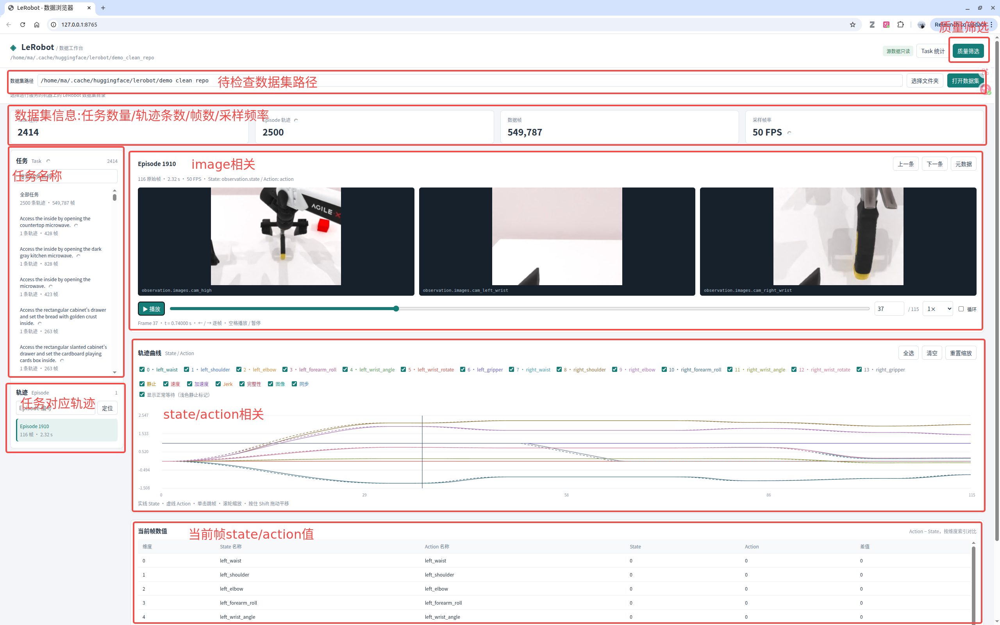
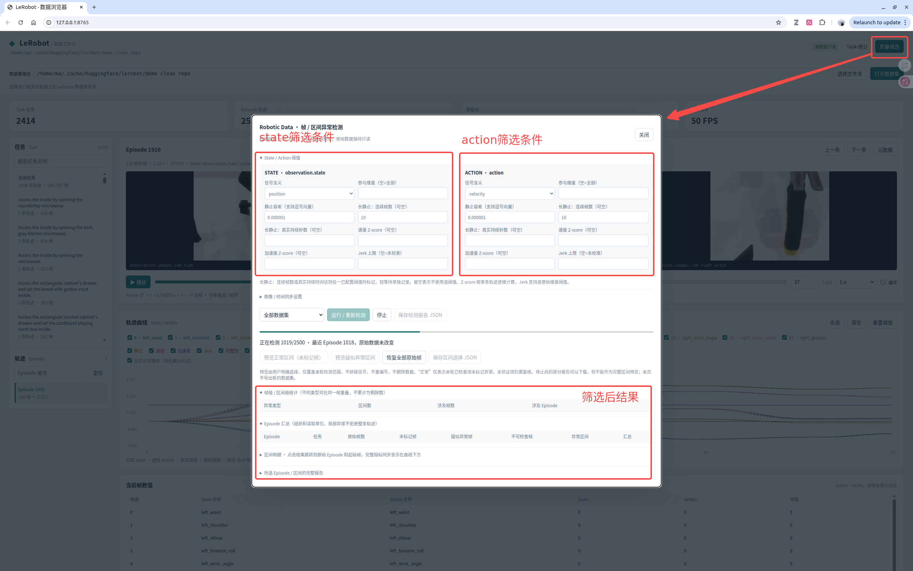
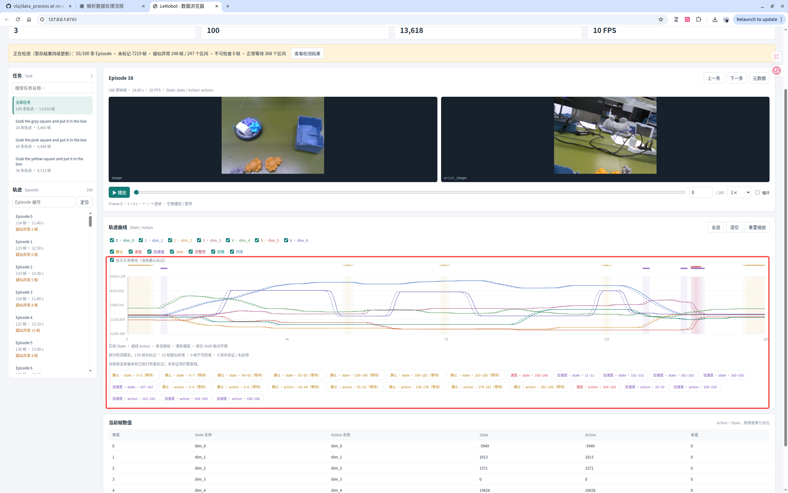

# LeRobot / VLA 数据工具

在本地浏览器中按 **Task → Episode → Frame** 浏览 LeRobot v2.0 / v2.1 数据，定位帧间运动异常并预览连续区间。
源数据集只读。程序依赖 NumPy、Pillow 和 PyArrow，HTTP 服务使用 Python 标准库，前端使用原生 ES 模块和 Canvas。

## 界面示例

<table>
  <tr>
    <th width="33%">主界面</th>
    <th width="33%">质量筛选界面</th>
    <th width="33%">检测结果示例</th>
  </tr>
  <tr>
    <td><a href="images/主界面.png"></a></td>
    <td><a href="images/质量筛选界面.png"></a></td>
    <td><a href="images/检测结果示例.png"></a></td>
  </tr>
</table>

点击缩略图可查看原图。

## 启动

在项目根目录运行：

```bash
# 仅安装数据工具依赖，无需 GPU、PyTorch 或 CUDA Toolkit
uv sync --locked --only-group data

# 启动服务并打开浏览器；省略 view 也可以
uv run --no-sync python -m data_process view

# 指定数据集和初始轨迹
.venv/bin/python -m data_process view --path playground/Dataset/piper_dataset --episode 0

# 自定义端口，不自动打开浏览器
.venv/bin/python -m data_process view --port 9000 --no-browser

# 在终端读取一帧
.venv/bin/python -m data_process read --path playground/Dataset/piper_dataset --episode 0 --frame 10
```

完整模型环境的安装方式见[项目 README](../README.md)。完整环境已经包含这些依赖，
无需再运行上面的轻量同步命令；可直接执行 `uv run --locked python -m data_process view`。
轻量环境使用 `--no-sync`，避免运行时自动补装模型依赖。

默认地址为 **http://127.0.0.1:8765**，按 `Ctrl+C` 停止。默认数据路径为项目下的
`playground/Dataset/demo_clean_repo`，可用 `--path` 覆盖。也可在页面顶部输入路径并点击 **打开数据集**，或通过 **选择文件夹** 浏览服务所在机器的目录。
路径支持绝对路径、相对服务启动目录的路径和 `~`。切换失败保留当前数据；质量检查运行时需先停止检查。
切换成功后重置轨迹、播放、预览和质量结果，同一服务的其他页面需要刷新。无需桌面显示服务、前端构建或 CDN。

远程访问可使用 `ssh -L 8765:127.0.0.1:8765 user@server`，然后在远端运行 `view --no-browser`。
`--host 0.0.0.0` 可供受信任局域网访问；服务没有登录系统，默认仅监听本机。

## 结构与职责

```text
data_process/
├── __main__.py      # 命令行：read / view
├── __init__.py      # 公共数据 API
├── config.py        # 默认路径、字段别名、质量策略及参数解析
├── dataset.py       # Parquet 读取、图像解码、字段适配与 Task / Episode 模型
├── processing.py    # 质量检查、指标缓存、报告与分阶段统计
├── report_store.py  # 按数据集 / 检测轮次 / Episode 保存、校验和导入报告
├── application.py   # 浏览数据、图像编码、后台质量任务和 JSON 转换
├── web_server.py    # HTTP 路由、静态资源、服务生命周期
├── web/
│   ├── index.html   # 页面结构
│   ├── style.css    # 页面样式和窄屏布局
│   ├── common.js    # 共享浏览状态、数据范围与通用操作
│   ├── app.js       # 页面入口、导航、帧同步和播放
│   ├── dataset.js   # 数据路径选择、目录浏览及切换
│   ├── chart.js     # 曲线、维度选择与缩放手势
│   ├── statistics.js # Task 统计、分布图和 CSV 下载
│   └── quality.js   # 质量表单、任务轮询、报告与筛选预览
├── tests/           # 数据适配、差分窗口、局部异常、质量任务与只读测试
├── requirements.txt
└── README.md
```

依赖方向为 `config → dataset → processing → report_store → application → web_server`。
命令行负责启动；数据和质量模块可单独使用，不导入 HTTP 或界面。`web_server.py` 只处理传输，
`application.py` 负责串行访问浏览读取器，并在独立线程中运行质量检查。
前端功能模块通过入口传入跳转、筛选回调，共享浏览状态，不互相循环导入。

浏览 API：`GET /api/info`、`/api/episode?episode=0`、`/api/frame?episode=0&frame=10`、
`/api/image?episode=0&frame=10&camera=image`。
数据集切换：`POST /api/dataset/open`，请求体为 `{"path":"/path/to/dataset"}`；
目录浏览：`POST /api/directories`，请求体为 `{"path":"/path/to/folder"}`。
质量任务：`POST /api/quality/start`、`POST /api/quality/stop`、`GET /api/quality/status?id=…&since=版本号`。
历史结果：`GET /api/quality/history`、`GET /api/quality/active`、`POST /api/quality/import`（`path`）；
单条明细：`GET /api/quality/episode?id=…&episode=0`；保存目录：`POST /api/quality/save`（`id`）。
POST 使用页面令牌和同源校验；源数据没有写入接口。

## 页面操作

- 任务：搜索、筛选轨迹；统计面板支持排序、长度分布、CSV 下载和点击跳转。
- 轨迹：列表选择、编号定位、前后切换及元数据查看。
- 帧：拖动滑条、输入帧号、左右键逐帧；空格播放 / 暂停，支持倍速与循环。
- 图像：同步显示内嵌相机的 JPEG 缩略图，点击读取原始分辨率 PNG；单路解码失败单独提示。
- 曲线：State / Action 多维选择、滚轮缩放、Shift 拖动平移、悬停查值、单击跳帧。
- 数值：逐维 State、Action、Action − State，以及当前帧原始数值字段。

图像、曲线和数值同步提交，过期响应不会覆盖新选择。播放速度受读取和解码耗时影响。
统计时长为 `帧数 / FPS`；多任务轨迹分别计入各 Task，跨 Task 汇总可能重复。

## 字段与数据 API

State / Action 别名位于 `config.py` 的 `FIELD_ALIASES`。字段不匹配或候选不唯一时指定：

```bash
.venv/bin/python -m data_process view --path /path/to/dataset --state-key qpos --action-key command
```

维度名来自元数据，缺失时使用 `dim_0` 等；多轴数值按原始顺序展平绘图，原始字段和形状保留。
State / Action 仅按维度索引对比，不推断单位或动作含义。目前不支持外部视频、LeRobot v3 和 HDF5。

```python
from data_process import BrowserModel, LeRobotReader

reader = LeRobotReader("playground/Dataset/piper_dataset")
frame = reader.read_frame(episode_index=0, frame_index=10)
raw = reader.read_episode(0, columns=["state", "actions"])

model = BrowserModel("playground/Dataset/piper_dataset")
episode = model.read_episode(0)
state, action = episode.state, episode.action  # (帧数, 实际维度数)
values = episode.frame(10)                    # 保留原始字段名和形状
images = model.read_images(0, 10)             # CHW RGB uint8
```

## 帧 / 区间异常检测

通过顶部 **质量筛选** 运行检测，Episode 仅作为读取和汇总单位。局部异常不会拒绝整条轨迹。
检测、区间选择和数据导出分开：运行检测只生成标记；预览由用户主动选择；当前不生成新的清洗数据集。

1. 设置 State / Action 的信号含义、原始维度索引和阈值，选择 Episode、Task 原始范围或全集。
2. 查看帧级统计、Episode 汇总及区间明细，可按类型、Episode 筛选，并分页查看。
3. 点击区间自动定位原始 Episode 和起始行索引，曲线按区间缩放；相机和数值保持同步。
4. 在曲线下方查看区间实际数值、触发阈值、异常维度、原始帧标识和完整差分窗口。
5. 主动选择 **预览正常区间（未标记帧）** 或 **预览疑似异常区间**；通过 **恢复全部原始帧** 返回原始范围。

检测发现异常时发布当前 Episode 的暂存结果，页面每 0.5 秒读取增量，更新统计、轨迹列表和曲线标记，
无需等待整轮完成。关闭质量面板后，主页面仍显示检测状态与异常数量，并可点击区间定位。
完整明细按当前查看的 Episode 读取，浏览器只缓存最近 3 条。检测中尚未完成的项目仍需等待后续结果，
暂存的“未标记帧”不代表整条轨迹已经检查完毕。

曲线上以不同颜色的背景和顶部独立条带显示静止、速度、加速度、Jerk、完整性、图像和同步标记。
类型可同时勾选，正常等待用浅色显示并可隐藏。多种异常可重叠，同一帧的总计只算一次。
“正常”仅表示本轮已执行检查未标记异常，**不代表缺失时间戳、未校准 Jerk 或清晰度等项目已通过**。

### 检测定义

| 检查 | 帧与区间规则 |
| --- | --- |
| 静止 | position / command 使用相邻帧全部选中维度的绝对变化量；velocity 使用近零速度；acceleration 无法推出静止。连续静止合并成区间，记录全部参与维度、容差、帧数、真实持续时间及异常区间的逐帧值 |
| 长静止阈值 | `static_min_frames`（默认 20 帧）或 `static_min_seconds`（默认 1 秒）达到任一已配置阈值时标记；可分别留空。不足阈值的静止保留为正常等待，不以整条轨迹的静止比例拒绝数据 |
| 速度 / 加速度 | 使用真实时间间隔逐阶差分，按单条 Episode、逐维的有限有效样本计算绝对 Z-score（默认 6）；超过阈值即记录该位置，不使用 Episode 异常比例作为拒绝条件 |
| Jerk | position / command 的三阶、velocity 的二阶、acceleration 的一阶时间差分；阈值支持标量或按原始字段宽度的向量。缺少阈值为未验证，不视作异常 |
| 完整性 | 标记 NaN / Inf、无效时间边、非连续原始帧标识和数值溢出。不能读取的轨迹记为不可检查，覆盖范围不伪装成正常 |
| 图像 | 保留解码、固定缩略图宽度下的 Laplacian 清晰度、低纹理 / 近黑白代理和运动中重复画面检查；逐帧标记，代理指标仍需人工复核。异常比例参考值只报告，不决定整条 Episode 是否保留 |
| 同步 | 对同一时钟域的独立采集时间戳标记超出容差的位置；缺少时钟或外参列为未验证，不由同行存储推断同步 |

差分的时间位于前阶时间的中点，每个样本记录 `metric_timestamp`、完整支撑窗口和窗口最右端的定位帧。
例如三阶差分定位在第 3 行时，其原始支撑窗口为第 0–3 行。连续的定位帧合并为区间，不把支撑窗口内所有正常帧自动删除。
静止的相邻帧区间包含参与首个静止差分的前一帧，持续时间为 `timestamp[end] - timestamp[start]`。

无效值逐维传播；差分不跨 Episode、不跨非递增 / 非有限时间边或采样缺口。缺口相对真实正时间间隔的中位数判断。
缺少真实时间戳时，位置与指令的运动导数为未验证；仍可检查数值和连续静止帧数，不使用 FPS 合成物理导数。
原生 velocity / acceleration 可检查已有的对应量，但其更高阶差分仍需真实时间戳。
有效样本少于 4 个的维度不计算 Z-score，常数信号的 Z-score 为 0。Z-score 不能识别所有持续性尺度异常。
`command` 的时间差分仅表示指令变化，不自动解释为真实机器人速度、加速度或 Jerk；单位由用户配置和校准。

### 区间预览与报告

预览保留原始 Episode ID、行索引、原始 `frame_index` 和 Timestamp。播放跳过未选中的区间，
曲线在间隙处断开，不拼接信号或重新编号，统计反映所选帧数。未检查轨迹不纳入本轮预览。
重新修改阈值会撤销旧的区间预览并将标记注明为上次检测，需重新运行才能应用当前参数的预览。
关闭面板后后台检测继续；停止后已完成的 Episode 保存在报告目录，正在检查的未完成 Episode 不冒充已完成结果。
部分报告不能应用为完整范围的区间选择。

### 自动保存与导入

默认自动保存到 `data_process/output/`，可在面板中修改保存根目录，必须位于原始数据集之外。
每轮检测独立保存；每条 Episode 完成后立即写入压缩明细和增量索引，避免把全部逐帧信息塞进一个巨大 JSON：

```text
output/
└── 数据集名称-路径摘要/
    └── 检测时间-随机标识/
        ├── manifest.json                # 策略、数据来源、范围、汇总与完成状态
        ├── index.jsonl                  # 每行一条 Episode 轻量索引 / 绘图区间
        └── episodes/
            ├── episode_000000.json.gz   # 单条 Episode 的完整 JSON（gzip）
            └── episode_000001.json.gz
```

**保存报告目录** 刷新保存信息并显示实际路径；文件保存在运行服务的机器上。
**导入先前检测信息** 可从本数据集历史列表选择，或输入报告目录、`manifest.json`、旧版帧 / 区间 v2 JSON 的路径。
旧单 JSON 会转换为上述目录，原文件保留。导入校验数据集路径、元数据、字段映射、帧数和区间范围；
新格式还校验各 Parquet 文件的大小与修改时间，源文件改变时需重新检测。
旧 JSON 没有文件指纹，只能校验其已有的来源和帧映射信息，不应导入来源不确定的旧报告。
早期 Episode 拒绝制报告不支持导入，需重新检测。

刷新页面或重启服务后，会从默认根目录恢复当前数据集最近一轮报告，标记持续可见；校验失败时提示重新选择。
使用自定义根目录的报告可通过路径再次导入。进程意外中断时可导入已写完的 Episode，报告仍标为部分完成。
历史报告导入会恢复对应检测阈值；调整参数后仍可复核旧标记，但需要重新检测才能按新参数预览。

报告内容保留 `version: 2` 和 `selection_unit: "frame_segment"`；每条压缩明细包含：

- `summary`：Episode 数、未标记 / 疑似异常 / 不可检查帧数、异常与等待区间数、按类型去重的涉及帧数。
- `episodes[].coverage` 和 `checks[].evaluated_frame_ranges`：数据覆盖、时间戳来源和每项有效检查范围；导数边界和无效窗口位于检查指标中，`coverage_per_dimension` 分别列出每个原始维度的有效和跳过范围。
- `episodes[].segments`：局部异常和正常等待区间、原始索引 / 时间、维度、数值、阈值和差分窗口。
- `episodes[].frame_flags`：逐异常帧的原始标识、时间戳、类型、涉及维度和区间引用。
- `normal_segments`、`suspect_segments`、`unchecked_segments`：按原始行索引合并的区间，供后续明确选择。

**保存区间选择 JSON** 单独下载当前主动选择的区间清单与策略，不包含庞大的检查明细。
检测报告和区间清单都不生成新的数据集，不修改原文件。同一服务同时执行一轮检测，
新任务成为当前报告，先前轮次仍保留在各自目录中；各页面独立保存浏览选择和预览范围。

```python
from dataclasses import replace
from data_process.config import QUALITY_POLICY
from data_process import BrowserModel
from data_process.processing import QualityInspector
from data_process.report_store import ReportBundle

policy = replace(QUALITY_POLICY,
    state=replace(QUALITY_POLICY.state, static_min_frames=25, static_min_seconds=None,
                  velocity_zscore=6, acceleration_zscore=6, jerk_limit=None),
    image_stride=5)
model = BrowserModel("playground/Dataset/piper_dataset")
bundle = ReportBundle.create(model, policy, [0, 1], "/tmp/quality_reports")
report = QualityInspector(model.loader.path).inspect([0, 1], policy,
    on_episode=bundle.append, retain_episodes=False)
bundle.finish(report["complete"])
print(bundle.root)  # 每条 Episode 独立压缩保存，内存中仅保留轻量索引
# 仅返回原始索引清单，不删除帧、不拼接成新的 Episode。
normal_ranges = {row["episode_index"]: row["normal_segments"] for row in report["episodes"]}
```

## 验证

```bash
.venv/bin/python -B -m unittest discover -s data_process/tests -v
```
